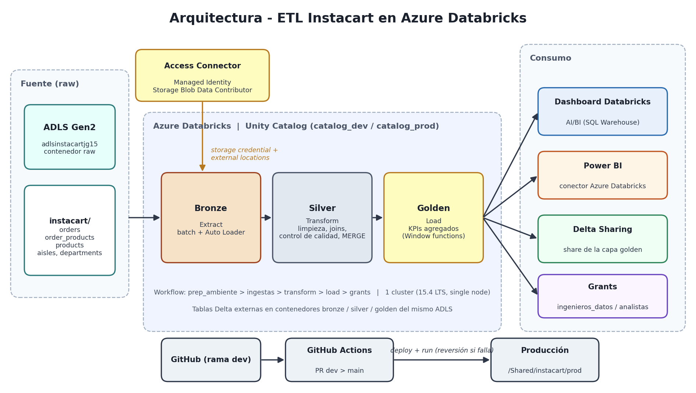
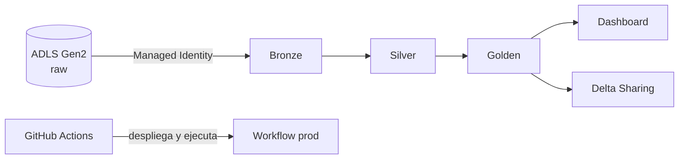
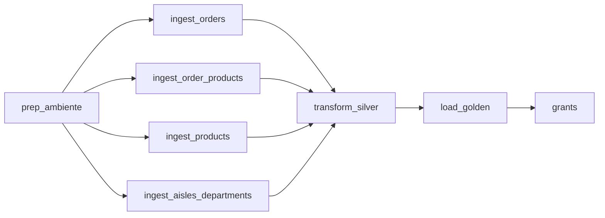
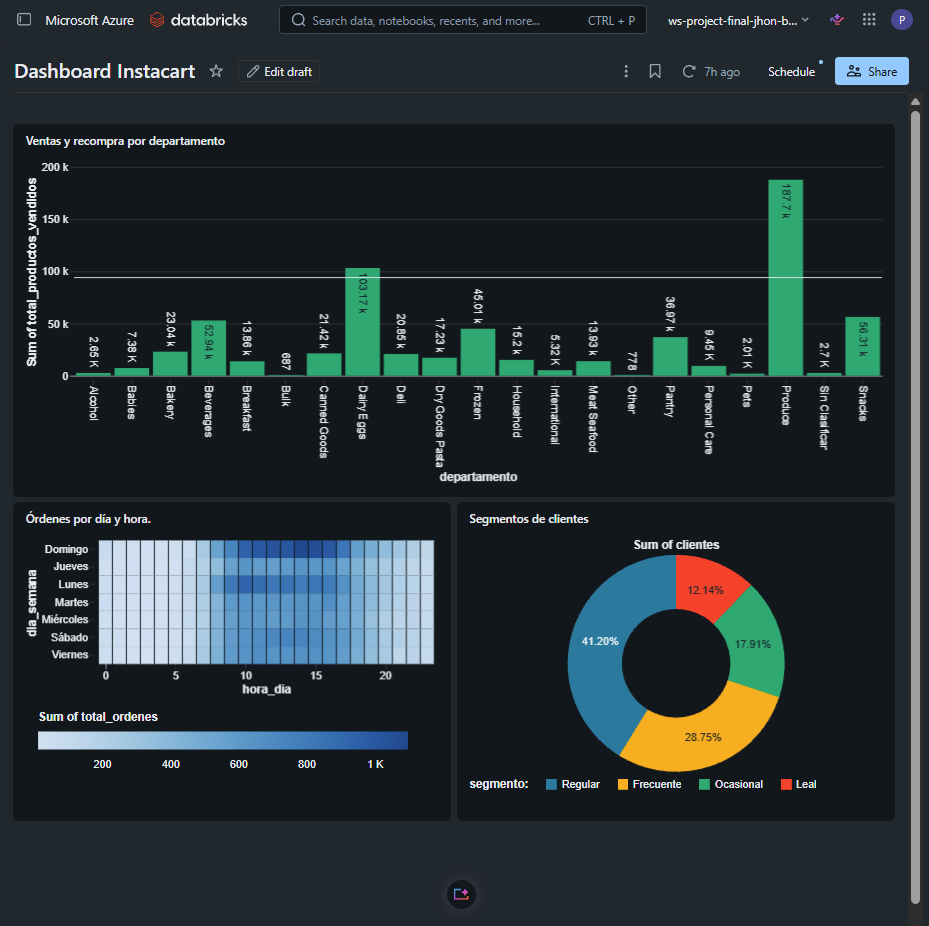

# Proyecto Final - ETL Instacart con Azure Databricks

Proyecto final del curso Ingeniería de Datos e IA con Databricks.

Se desarrolló un ETL en Azure Databricks con arquitectura medallion (bronze, silver y golden) usando PySpark. Los datos se leen desde un Azure Data Lake Storage Gen2 mediante Managed Identity, las tablas se gobiernan con Unity Catalog y el despliegue a producción se realiza con GitHub Actions. Los resultados se muestran en un dashboard de Databricks.

## Objetivo

Con los datos de órdenes de un supermercado online se buscó responder:

- Qué departamentos venden más y en cuáles los clientes vuelven a comprar los mismos productos.
- Cuáles son los productos más comprados de cada departamento.
- En qué días y horas se concentran las compras.
- Cómo se pueden agrupar los clientes según su frecuencia de compra.

## Arquitectura





Recursos utilizados:

- Storage Account ADLS Gen2 con los contenedores `raw`, `bronze`, `silver`, `golden` y `catalog`.
- Access Connector for Azure Databricks (Managed Identity) con el rol Storage Blob Data Contributor sobre el storage.
- Azure Databricks con Unity Catalog: una storage credential y una external location por contenedor.
- Un solo workspace con dos catálogos: `catalog_dev` para desarrollo y `catalog_prod` para producción.

| | Desarrollo | Producción |
|---|---|---|
| Catálogo | `catalog_dev` | `catalog_prod` |
| Notebooks | Git folder (rama `dev`) | `/Shared/instacart/prod` |
| Ejecución | manual | Workflow `wf_etl_instacart_prod` |
| Ruta de las tablas | `abfss://<capa>@<storage>/catalog_dev/<tabla>` | `abfss://<capa>@<storage>/catalog_prod/<tabla>` |

### Cluster

Se usa un único cluster para ambos ambientes.

| Parámetro | Valor |
|---|---|
| Policy | Unrestricted |
| Runtime | 15.4 LTS (Spark 3.5.0) |
| Nodo | Standard_D4ds_v4 (16 GB, 4 cores), single node |
| Access mode | Dedicated |
| Photon | Desactivado |
| Auto terminación | 20 minutos |

Photon venía activado por defecto y se desactivó porque aumenta el costo en DBU y, con el volumen de datos del proyecto (alrededor de un millón de filas por tabla), la mejora en tiempo no es significativa. Además, una parte de la transformación usa una UDF de Python, que Photon no acelera.

## Dataset

Se utilizó el [Supermarket / Superstore Dataset Bundle](https://www.kaggle.com/datasets/amunsentom/supermarket-superstore-dataset-bundle) de Kaggle, que contiene las órdenes de Instacart. Se trabajó con los siguientes archivos:

| Archivo | Contenido |
|---|---|
| `orders.csv` | Órdenes: cliente, día, hora y días desde la orden anterior |
| `order_products__prior.csv` | Productos de cada orden (historial) |
| `order_products__train.csv` | Productos de cada orden (última orden) |
| `products.csv` | Productos |
| `aisles.csv` | Pasillos |
| `departments.csv` | Departamentos |

Observaciones sobre los archivos:

- El separador es `;` y en `products.csv` cada línea termina con un `;` adicional.
- Algunos nombres de productos tienen comillas escapadas.
- Los pasillos y departamentos sin clasificar aparecen como `missing`.
- Los archivos más grandes están cortados en 1 048 576 líneas (límite de Excel), por lo que muchas líneas de `order_products` no tienen su orden en `orders.csv`. En silver se cuentan esas líneas, se registran en el log y se descartan. En la ejecución se descartaron 1 458 558 de 2 097 150 líneas (69.5 %) y quedaron 638 592 registros en `silver.detalle_ordenes`.

## ETL

### Bronze (`proceso/02_ingest_*`)

Se leen los CSV desde `abfss://raw@<storage>.dfs.core.windows.net/instacart/<entidad>/` con un schema definido y se agregan las columnas `ingestion_date` y `source_file`.

| Tabla | Carga |
|---|---|
| `bronze.orders` | batch, overwrite |
| `bronze.order_products` | Auto Loader con `availableNow` y checkpoint |
| `bronze.products` | batch, overwrite |
| `bronze.aisles`, `bronze.departments` | batch, overwrite |

### Silver (`proceso/03_transform`)

| Tabla | Transformaciones | Carga |
|---|---|---|
| `silver.productos` | join con pasillos y departamentos, limpieza de texto, `initcap`, indicador de producto orgánico | overwrite |
| `silver.ordenes` | se excluyen las órdenes `test`, validación de rangos, nombre del día con UDF, franja horaria | merge por `order_id` |
| `silver.detalle_ordenes` | join de detalle, órdenes y productos, control de registros sin orden, partición por departamento | merge por `order_id` y `product_id` |

### Golden (`proceso/04_load`)

| Tabla | Contenido |
|---|---|
| `golden.kpi_departamentos` | productos vendidos, órdenes, clientes, tasa de recompra y participación por departamento |
| `golden.top_productos` | 10 productos más comprados por departamento (`row_number`) |
| `golden.actividad_dia_hora` | órdenes y productos por día y hora |
| `golden.segmentos_clientes` | órdenes, recompra, departamento favorito y segmento de cada cliente |

Todos los notebooks reciben los parámetros `catalogo` y `storage_name`, por lo que el mismo código se ejecuta en desarrollo y en producción. Las funciones comunes están en `proceso/00_utils`.

## Workflow

El job está definido en `proceso/workflow/wf_etl_instacart.json`:



## CI/CD

El archivo `.github/workflows/deploy-prod.yml` se ejecuta con cada push a `main`:

1. Importa los notebooks de `proceso/` en `/Shared/instacart/prod`.
2. Reemplaza en el JSON del job el cluster, el catálogo `catalog_prod` y el storage.
3. Crea el job o lo actualiza si ya existe.
4. Ejecuta el job y espera a que termine. Si alguna tarea falla, el pipeline también falla.
5. Si el despliegue o el job fallan, se ejecuta el job `rollback`, que corre `reversion/drop_medallion` sobre `catalog_prod` y deja el ambiente limpio para el siguiente despliegue.

Solo se despliegan los notebooks de `proceso/`. El notebook de reversión se importa en `/Shared/instacart/reversion` únicamente cuando hay una falla.

El desarrollo se hace en la rama `dev` y los cambios pasan a producción mediante un pull request a `main`.

Secrets configurados en el repositorio:

| Secret | Descripción |
|---|---|
| `DATABRICKS_HOST` | URL del workspace |
| `DATABRICKS_TOKEN` | Token de acceso personal |
| `DATABRICKS_CLUSTER_ID` | ID del cluster |
| `STORAGE_ACCOUNT_NAME` | Nombre del storage account |

## Seguridad

| Grupo | Permisos |
|---|---|
| `ingenieros_datos` | lectura y escritura en bronze, silver y golden |
| `analistas` | solo lectura en golden |

Los permisos se asignan en la última tarea del workflow (`proceso/05_grants`). La versión en SQL está en `seguridad/grants.ipynb`.

### Delta Sharing

Delta Sharing permite compartir tablas de Unity Catalog con alguien que no tiene acceso al workspace. Se crea un share con las tablas de KPIs de golden y un destinatario (recipient). El destinatario recibe un enlace de activación, descarga sus credenciales y lee las tablas desde Power BI, pandas o Spark, siempre con la última versión de los datos y sin copiarlos.

- `delta-sharing/delta_sharing.ipynb`: crea el share `share_instacart_golden`, agrega las tablas, crea el recipient `recipient_area_comercial` y le otorga SELECT.
- `delta-sharing/delta_sharing_sql.ipynb`: versión en SQL.

## Reversión

- `reversion/drop_medallion.ipynb`: elimina las tablas, sus carpetas en el Data Lake, el checkpoint de Auto Loader y los schemas. Opcionalmente elimina el catálogo. Se ejecuta automáticamente desde GitHub Actions cuando falla el despliegue a producción.
- `reversion/drop_medallion_sql.ipynb`: versión en SQL.

## Dashboard

El dashboard se construyó en Databricks sobre las tablas de `catalog_prod.golden`. Las consultas están en `dashboard/queries_dashboard.ipynb`.



Produce y Dairy Eggs son los departamentos con más productos vendidos, y la mayor parte de las órdenes se concentra entre las 9 y las 17 horas.

## Estructura del repositorio

```
├── .github/workflows/   pipeline de despliegue a producción
├── PrepAmb/             external locations, catálogos, schemas y tablas
├── proceso/             notebooks del ETL y definición del workflow
├── seguridad/           grants
├── delta-sharing/       script de Delta Sharing
├── reversion/           eliminación de objetos
├── dashboard/           consultas y capturas del dashboard
├── datasets/            archivos CSV
├── evidencias/          capturas del proyecto
└── certificaciones/
```

Todos los scripts son notebooks `.ipynb`. Los de `proceso/` están en PySpark; los scripts SQL de `PrepAmb/`, `seguridad/`, `reversion/`, `delta-sharing/` y `dashboard/` usan celdas con el magic command `%sql`.

## Pasos para el despliegue

1. Crear el storage account con hierarchical namespace y los contenedores `raw`, `bronze`, `silver`, `golden` y `catalog`.
2. Subir los archivos a `raw/instacart/<entidad>/` (por ejemplo `raw/instacart/orders/orders.csv`).
3. Crear el Access Connector y asignarle el rol Storage Blob Data Contributor en el storage.
4. En Databricks, crear la storage credential `cred_instacart_jhon_garcia_15_nov` con el ID del Access Connector.
5. Crear el cluster con la configuración indicada.
6. Ejecutar `proceso/01_prep_ambiente` (o los scripts de `PrepAmb/`) y luego los demás notebooks en orden, con `catalogo = catalog_dev`.
7. Crear los grupos `ingenieros_datos` y `analistas`.
8. Configurar los secrets en GitHub y hacer merge a `main` para desplegar en producción.

## Evidencias

| Evidencia | Archivo |
|---|---|
| Arquitectura | `evidencias/00_arquitectura.png` |
| Recursos en Azure | `evidencias/01_recursos_azure.png` |
| Rol del Access Connector en el storage | `evidencias/02_managed_identity.png` |
| External locations | `evidencias/03_external_locations.png` |
| Catálogos y tablas | `evidencias/04_unity_catalog.png` |
| Ejecución de GitHub Actions | `evidencias/05_github_actions.png` |
| Ejecución del workflow en producción | `evidencias/06_workflow_prod.png`, `evidencias/06_workflow_prod2.png` |
| Grants por grupo | `evidencias/07_grants.png` |
